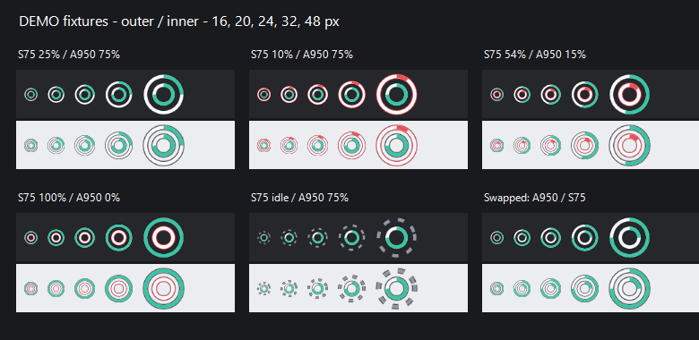

# 无线外设电量 · Peripheral Battery

轻量的 Windows 原生托盘工具，独立查询 **达尔优 A950** 和 **新盟 S75** 的 2.4GHz 接收器电量。C++ / Win32 负责常驻托盘与浮层，已验证的 C# / .NET 8 HID 查询在短命子进程中执行；设置和诊断窗口按需启动、关闭即退出。无浏览器、无厂商后台依赖。


> 图示为实机采样的 UI 渲染；设备休眠或断连时不显示旧百分比。首次硬件验证：A950 50%，S75 57%，后续 S75 56%。这些是测试时的读数，不是固定展示数据。

推荐下载 [Windows 安装程序](https://github.com/wgen95/peripheral-battery-tray/releases/download/v2.0.0/PeripheralBattery-2.0.0-Setup-x64.exe)，双击安装后即可从开始菜单打开。安装程序自带 .NET；正常运行无需联网、管理员权限或替换设备驱动，默认不开机自启。

**低内存常驻：**v2.0.0 的常驻进程不加载 CLR / WinForms。实机覆盖安装验证：v1.4.0 常驻工作集 88.7 MiB；v2.0.0 在打开并关闭设置 / 诊断后，105 秒样本的常驻工作集中位数 16.93 MiB，私有内存 3.29 MiB，查询期间观察到的主进程 + 查询子进程工作集合计峰值 69.66 MiB。冷启动未打开界面时约 11.3 MiB。不是在所有阶段都只占 17 MiB：打开设置 / 诊断或查询时会短暂使用更多内存，关闭 / 查询结束后对应进程退出。没有周期性清空工作集来压低数字。详见 [内存说明](docs/06-memory.md)。

**省电说明：**旧版每分钟主动查询 S75，虽然没有修改键盘设置，但可能干扰固件闲置倒计时。v1.2.0 改为闲置时不查询键盘。Windows 键盘活动通知只保留活动时间，不读取、保存或上传按键内容；无键盘活动通知时保持暂停查询。

安装版默认位于 `%LOCALAPPDATA%/Programs/PeripheralBattery`，提供开始菜单入口和可选桌面快捷方式。在 Windows **设置 → 应用 → 已安装的应用 → 无线外设电量 → 卸载** 即可删除。卸载会正常退出程序，并清理程序文件、快捷方式、自启动项、配置、日志及本应用的 .NET 解包缓存。覆盖安装可以升级。安装包尚未进行代码签名。

浮层只显示 `A950`、`S75` 和各自电量 / 状态，设备名称仅含字母与数字。面板为 136×58 逻辑像素。

- 左键托盘图标：打开 / 收起深色两行面板；点外部或按 Esc 收起。
- 鼠标悬停：紧凑浮层；可在设置中关闭，保留原生电量摘要。
- 右键：显示电量、立即刷新、设备诊断、设置、查看日志、退出。
- 鼠标默认每 60 秒查询；可设 15–600 秒。S75 仅在检测到键盘活动后的 30 秒窗口内查询，闲置后停止主动通信，显示“待使用”，不把它误称为硬件休眠，也不展示旧百分比。启动、USB 重插及系统恢复不会主动唤醒闲置键盘。
- “立即刷新”属于主动查询，可能唤醒设备；悬停 / 点击查看面板不会发出额外查询。
- 低于阈值时数字变色。关闭浮层或诊断窗口继续后台运行。
- 双环托盘默认外环 S75、内环 A950，在设置的“内外环设备”中可对调，保存后立即生效。默认黑白配：黑色代表剩余电量，白色代表已消耗；白色消耗弧以 6 点钟方向为中心，两侧对称变化。设置中的“托盘配色”可切换黑白、青绿 / 白、蓝 / 白、绿 / 白、紫 / 白、橙 / 白，保存后立即生效。达到设置中的低电量阈值时，对应环变红。0% 以白色空环和细红边表示。
- 没有有效电量（含闲置、断连、读取失败）时，对应环显示灰色虚线，不沿用旧读数。
- 图标可能被 Windows 收纳在 `^` 中，可通过任务栏设置选择常驻显示。拖动期间不会弹出浮层；固定 GUID 保持不变。



## 已验证设备

| 设备 | 2.4GHz 接口 | 独立读数 |
|---|---|---|
| 达尔优 A950 | 260D:1074，FF02 查询 / FF01 回复，17 字节 Compx 协议 | 本机 C# 与独立 Python 探针均取得通过校验的百分比 |
| 新盟 S75 标准版 | 0C45:FEFA，FF60:0061，内部身份 0C45:8006 / 2:15 | 本机取得官方 GET_DEVICE_INFO 电量字段；验证失败后恢复 |
| Compx 260D:1084 接口 | 相同查询通道 | 单独探针取得有效帧，但具体物理型号未确认；仅可手动选择 |

**不能将这张表推广到 A950 Pro/Air/Wing 或 S75 Pro。** 同一 VID/PID 可能被多个产品共享；S75 会额外检查内部产品标识。仅对本次实测的固件与接口确认可用。充电状态尚未验证，不在 UI 宣称支持。

标准 HID 电池接口只做描述能力检查，未实现适用于任意外设的通用读数。陌生设备不会自动猜测协议或发送设置命令。所有百分比来自验证后的电量报告，绝不从在线状态或无线信号推算。

## 构建与测试

需要 Windows 10/11 x64、.NET 8 SDK（8.0.400 或更新的 8.0 SDK），以及 MSVC 开发者命令行（含 Windows SDK）或 MinGW-w64 的 g++ / windres。

```powershell
./build.ps1 -Installer
# SDK 不在 PATH 时：
./build.ps1 -Installer -Dotnet 'C:/path/to/dotnet.exe'
# 同时生成安装程序（需 Inno Setup 6.3+）
./build.ps1 -Installer -Iscc 'C:/path/to/ISCC.exe'

# 已有安装版的本机升级验证（不启动应用，不运行便携版）
./tools/test-installed-upgrade.ps1
# 协议与状态测试（无需硬件）
dotnet run --project tests/PeripheralBattery.Tests
# 真实硬件诊断（本机信息写入指定文件）
New-Item -ItemType Directory -Force evidence
dotnet run --project tests/PeripheralBattery.Tests -- --hardware evidence/probe.json
# 安装版内存采样（会启动已经安装的应用，不运行便携副本）
./tools/measure-installed-memory.ps1 -Seconds 105
```

自包含单文件发布因附带运行时而比源码 / 依赖框架版本大，首次启动也需要解包原生库；实际大小见 Release。发行包仅提供安装程序和 SHA256SUMS.txt。本机应用验证统一覆盖安装，不运行发布暂存目录中的可执行文件。

CLI（WinExe 不输出控制台，诊断请读取 JSON 或日志）：

```powershell
./PeripheralBattery.exe --show
./PeripheralBattery.exe --diagnostics
./PeripheralBattery.exe --settings
./PeripheralBattery.exe --diagnose ./diagnostics.json
./PeripheralBattery.exe --quit
```

重复启动会通知当前实例。`--diagnose` 是有 8 秒看门狗的独立诊断，可与托盘程序并行但可能争用厂商通道，建议先退出托盘再运行。

## 目录

```text
src/PeripheralBattery.Core/      HID 枚举、报告描述、协议校验、设备适配、状态模型
src/PeripheralBattery.App/       托盘、浮层、诊断、设置、查询进程管理、日志
tests/PeripheralBattery.Tests/  协议和状态断言、独立硬件探针入口
tests/PeripheralBattery.UiTests/ 旧托盘实现的参考测试，非 v2 原生前端验收
src/PeripheralBattery.Native/   原生常驻前端、双环绘制、浮层与子进程管理
tools/                          阶段二 Python 对照探针（仅开发，需 hidapi）
docs/                           可行性、协议依据、测试结果、排查说明
build.ps1                       可重复构建、测试、发布、打包和 SHA256
installer/                      Inno Setup 安装与卸载配置
```

配置与滚动日志保存在 `%LOCALAPPDATA%/PeripheralBattery`。自启动写入当前用户的 `HKCU/Software/Microsoft/Windows/CurrentVersion/Run`，可在设置取消。日志不持续记录每个不变读数；超过 1 MiB 轮换一次。诊断导出包含本机 HID 路径等信息，公开前请自行检查。原始本机 `evidence/` 不提交。

阅读 [可行性调查](docs/01-feasibility.md)、[读取协议](docs/02-protocols.md)、[测试与验收](docs/03-test-report.md)、[故障排查](docs/04-troubleshooting.md)。
